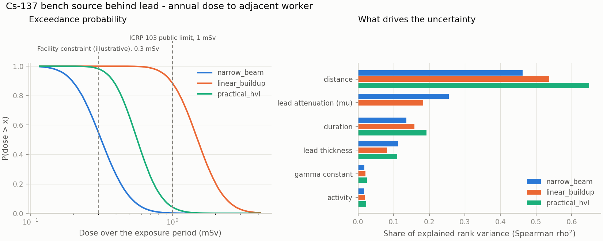

# RadSafe Scenario Simulator

Radiation-protection exposure scenario modelling in Python: simulate a controlled
gamma source, compare simplified shielding assumptions side by side, and propagate
uncertainty in distance, exposure time, activity and attenuation to a **distribution**
of dose, not a single number.

> **Educational and research tool.** It uses deliberately simplified models and
> illustrative reference data. It is **not** a shielding design tool and must not be
> used for regulatory compliance, dose assignment, or safety decisions. Those need
> a qualified radiation protection expert and validated codes. See
> [Limitations](#limitations).

## What it answers

| Question | How |
|---|---|
| How much dose accumulates at distance *d* over time *t*, behind a shield? | Inverse-square point source × shielding transmission × time |
| How much does the *shielding assumption* matter? | Narrow-beam, linear-buildup and practical-HVL models run on identical samples |
| How uncertain is the answer? | Monte Carlo propagation of activity, distance, duration, shield thickness and attenuation (μ) |
| How likely is it to exceed a limit or constraint? | Exceedance probability with a Monte Carlo confidence interval |
| What should I measure or control more carefully? | Spearman rank sensitivity of dose to each input |

## Quickstart

```bash
pip install -e ".[dev]"          # numpy + pyyaml (+ matplotlib, pytest, ruff for dev)

radsafe run scenarios/cs137_bench_source.yaml --plot summary.png
radsafe run scenarios/co60_irradiator_corridor.yaml --json report.json
radsafe validate scenarios/*.yaml
radsafe list                     # built-in sources, materials, shielding models
```

Example (`scenarios/cs137_bench_source.yaml`: 3.7 GBq Cs-137, worker at ~2 m, 3 cm lead, ~150 h/year):

```
Dose over the exposure period (mSv)
model           nominal  median  mean     P5    P95    P99
--------------  -------  ------  ----  -----  -----  -----
unshielded         13.9    13.8  14.6   8.68   23.2   29.4
narrow_beam       0.316   0.315  0.34  0.172  0.592  0.778
linear_buildup     1.51    1.51  1.61  0.863   2.72   3.52
practical_hvl     0.566   0.565   0.6  0.343  0.973   1.25

P(dose > limit)
model           Facility constraint (illustrative) (0.3 mSv)  ICRP 103 public limit (1 mSv)
narrow_beam                                            55.3%                         0.179%
linear_buildup                                          100%                          88.5%
practical_hvl                                          98.3%                          4.29%
```

Same source, same shield, same inputs: the answer to "does this exceed 1 mSv?" is
*0.2%*, *4%* or *88%* depending on the shielding assumption. The spread between
models (median dose differs by 1.8-4.8x here, 9-14x in the Co-60 example) is comparable to
or larger than the spread from all input uncertainties combined, which is why the models
are compared rather than picked.



## Describing a scenario

A scenario is a YAML file. Any numeric value can be a constant or a distribution.

```yaml
name: Cs-137 bench source behind lead
source:
  nuclide: Cs-137
  activity_mbq: { dist: lognormal, median: 3700, gsd: 1.05 }
geometry:
  distance_m: { dist: normal, mean: 2.0, sd: 0.25, lower: 0.5 }
exposure:
  duration_h: { dist: triangular, low: 100, mode: 150, high: 200 }
shielding:
  models: [narrow_beam, linear_buildup, practical_hvl]
  layers:
    - material: lead
      thickness_cm: { dist: normal, mean: 3.0, sd: 0.1 }
      mu_rel_unc: 0.05
      hvl_cm: 0.65
limits:
  - { name: ICRP 103 public limit, msv: 1.0 }
```

Full reference: [docs/scenario-schema.md](docs/scenario-schema.md).

## Python API

```python
from radsafe import load_scenario, run_simulation, build_report, format_text

scenario = load_scenario("scenarios/cs137_bench_source.yaml")
result = run_simulation(scenario, n_samples=50_000, seed=1)

result.dose_usv["narrow_beam"]        # numpy array of per-sample doses, uSv
report = build_report(result)         # plain dict (what --json writes)
print(format_text(report))
```

## Repository layout

```
src/radsafe/
  distributions.py   input uncertainty: constant / uniform / normal / lognormal / triangular
  sources.py         nuclide data (gamma constant, effective energy)       -> data/sources.yaml
  materials.py       NIST XCOM attenuation, log-log interpolation          -> data/materials.yaml
  dose.py            inverse-square dose rate, dose = rate x time
  shielding.py       narrow_beam / linear_buildup / practical_hvl models
  scenario.py        validated scenario dataclasses + strict YAML loader
  montecarlo.py      sampling + propagation (common random numbers across models)
  sensitivity.py     Spearman rank sensitivity
  risk.py            summaries, exceedance + Wilson CI, ICRP limits and nominal detriment
  report.py          JSON-able report and text tables
  plotting.py        optional matplotlib figure
  cli.py             radsafe run | validate | list
scenarios/           illustrative example scenarios
tests/               physics checks, analytic Monte Carlo checks, validation, CLI
docs/                physics, uncertainty, schema, architecture, roadmap
examples/            standalone scripts
```

## Physics in one paragraph

Dose rate from an unshielded point source is `Γ·A / d²`, with `Γ` the ambient dose
equivalent rate constant H\*(10) in µSv·m²/(MBq·h). Shields multiply that by a
transmission `T`: `exp(-Σμx)` for narrow beam (optimistic, unscattered photons only),
`(1+Σμx)·exp(-Σμx)` for a crude broad-beam buildup correction, or `2^-(Σx/HVL)`
using practical half-value layers you supply. Attenuation coefficients μ come from NIST
XCOM tables. Dose is rate × duration. Details and validity limits:
[docs/physics.md](docs/physics.md).

## Data provenance

* **Attenuation (μ/ρ)** for lead, iron, concrete and water: NIST X-Ray Mass
  Attenuation Coefficients, 0.5–2 MeV, transcribed in
  [`materials.yaml`](src/radsafe/data/materials.yaml).
* **Gamma constants** for Cs-137 and Co-60 are mid-range values of published
  tabulations that differ by a few percent; a 5% uncertainty is carried through. They
  are marked *illustrative: verify before use* in
  [`sources.yaml`](src/radsafe/data/sources.yaml).
* **Practical HVLs** in the example scenarios are common rule-of-thumb values, marked
  illustrative in the scenario files.
* **Dose limits / risk coefficients**: ICRP Publication 103 (2007).

Replace any of these with your own validated data; they are plain YAML.

## Testing

```bash
pytest          # 100+ tests, < 1 s
```

Beyond unit tests, the suite checks the Monte Carlo engine against closed-form results
(e.g. for `D ∝ A/d²` with log-normal inputs, `Var[ln D]` is known exactly), verifies that
adding a shielding model does not reshuffle the random streams of other inputs, and
checks that thicker shields amplify attenuation uncertainty exponentially, as theory says.

## Limitations

Point isotropic source; slab shields at normal incidence; no room scatter or skyshine;
one effective photon energy (so no broad spectra such as Ir-192 or X-ray tubes); no
source decay; no neutron, beta or internal exposure; inputs sampled independently.
See [docs/physics.md](docs/physics.md#what-is-not-modelled) for the full list and
[docs/roadmap.md](docs/roadmap.md) for what is planned.

## Development

```bash
make install   # editable install with dev extras
make check     # ruff + pytest
```

CI runs lint and tests on Python 3.10–3.13.

## License

MIT, see [LICENSE](LICENSE).
